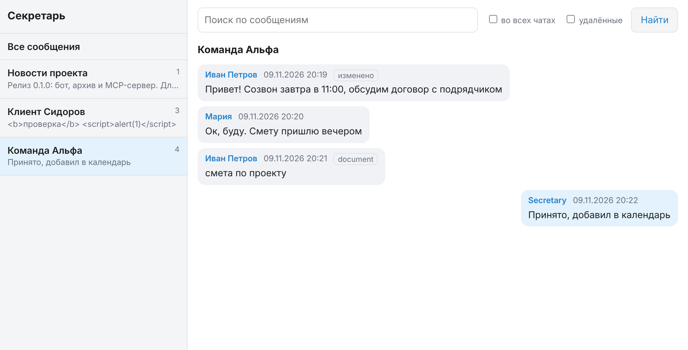

# tg-secretary-mcp

Telegram-секретарь для AI-агентов. Бот на Go читает сообщения через Bot API и складывает их в SQLite
с полнотекстовым индексом. Агенты (Hermes Agent, Claude и любые другие MCP-клиенты) получают
инструменты для чтения, поиска и, если включить, отправки сообщений. Для людей есть простой
веб-интерфейс просмотра и поиска.

Всё это один статический бинарник `tg-secretary`: без cgo, без внешних сервисов и баз данных.

```
                 Bot API (long polling)
   Telegram  ─────────────────────────────▶  collector ──┐
                                                         ▼
                                              ┌────────────────────┐
                                              │ SQLite (WAL, FTS5) │
                                              └────────────────────┘
                                                  ▲            ▲
                          MCP (HTTP /mcp, stdio)  │            │  веб-интерфейс (/)
                                                  │            │
                                    агент (Hermes, Claude)   браузер
```

## Возможности

- Архив всех сообщений, которые видит бот: текст, подписи к вложениям, тип вложения, ответы, правки.
- Полнотекстовый поиск (FTS5): все слова должны совпасть, поддерживается поиск по началу слова,
  регистр не учитывается, в том числе для кириллицы.
- Правки обновляют сохранённое сообщение; удаления в бизнес-чатах помечаются, а не стираются.
- Лента «что нового» с позицией, которая хранится в базе отдельно для каждого агента (`consumer`).
- MCP по Streamable HTTP (`/mcp`, Bearer-токен) или по stdio.
- Веб-интерфейс на серверном рендеринге, без JavaScript.
- Необязательная отправка сообщений от имени бота (выключена по умолчанию).

## Что бот видит и чего не видит

Bot API отдаёт боту только то, что ему адресовано или видно, и только пока он запущен.
Истории «задним числом» нет: всё, что было написано до запуска бота, в архив не попадёт.

| Где | Что нужно сделать |
| --- | --- |
| Личка с ботом | Написать боту `/start` |
| Группы | Добавить бота и отключить Privacy Mode в @BotFather (`/setprivacy` → Disable) либо сделать бота админом |
| Каналы | Добавить бота администратором |
| Ваши личные переписки | Telegram → Настройки → Telegram для бизнеса → Чат-боты (нужен Premium). В @BotFather для бота должен быть включён Business Mode |

Ограничения:

- Вложения не скачиваются: сохраняются тип (`photo`, `voice`, `document` и т. д.) и подпись.
- Об удалении сообщений бот узнаёт только в бизнес-чатах.
- Получать обновления (`getUpdates`) с одним токеном может только один процесс.
  Подробнее в [docs/architecture.md](docs/architecture.md).

## Быстрый старт

Сначала создайте бота у @BotFather и получите токен.

### Готовый бинарник

Архивы для Linux (amd64, arm64, armv7, armv6), macOS (amd64, arm64) и Windows (amd64) лежат на странице
[Releases](https://github.com/mac3g0d/tg-secretary-mcp/releases). Рядом с ними лежит `checksums.txt` (sha256).
В архиве: бинарник `tg-secretary`, `README.md`, `LICENSE` и `.env.example`.

Для Orange Pi PC Plus и других 32-битных плат на ARMv7 нужен `linux_armv7`.
Пошаговая инструкция: [docs/deployment.md](docs/deployment.md#orange-pi-pc-plus-armbian).

```bash
cp .env.example .env
```

Впишите в `.env` токен (`TELEGRAM_BOT_TOKEN`) и запустите:

```bash
./tg-secretary serve
```

### Сборка из исходников

Нужен Go 1.26 или новее.

```bash
git clone https://github.com/mac3g0d/tg-secretary-mcp.git
```

```bash
cd tg-secretary-mcp && cp .env.example .env
```

Впишите в `.env` токен и запустите:

```bash
make run
```

MCP-сервер поднимется на `http://127.0.0.1:8080/mcp`, веб-интерфейс на `http://127.0.0.1:8080/`.

### Docker

```bash
docker build -t tg-secretary .
```

```bash
docker run -d --name tg-secretary --env-file .env -e MCP_ADDR=0.0.0.0:8080 -e MCP_AUTH_TOKEN=change-me -p 127.0.0.1:8080:8080 -v tg-secretary-data:/app/data tg-secretary
```

Внутри контейнера база лежит в `/app/data/secretary.db`. Публиковать порт не на `127.0.0.1`
без TLS-прокси не стоит, см. [раздел о безопасности](#безопасность).

## Режимы запуска

| Команда | Что делает |
| --- | --- |
| `tg-secretary serve` | Бот, MCP по HTTP и веб-интерфейс в одном процессе. Основной режим |
| `tg-secretary bot` | Только бот-сборщик |
| `tg-secretary stdio` | Только MCP по stdio, читает ту же базу |
| `tg-secretary version` | Печатает версию |

Флаги: `serve -no-bot` (не запускать бота в этом процессе) и `stdio -with-bot` (запустить бота).
Бот должен работать ровно в одном процессе: либо `serve`, либо `bot` плюс любое число `stdio`.
Подробности: [docs/configuration.md](docs/configuration.md).

## Настройки

Переменные читаются из окружения и из файла `.env` в рабочей директории; окружение приоритетнее.

| Переменная | По умолчанию | Описание |
| --- | --- | --- |
| `TELEGRAM_BOT_TOKEN` | — | Токен бота. Обязателен для `serve` и `bot` |
| `TG_DB_PATH` | `data/secretary.db` | Файл SQLite (путь относительно рабочей директории) |
| `TG_ALLOWED_CHATS` | пусто (все чаты) | ID чатов через запятую, которые разрешено сохранять |
| `TG_ALLOW_SEND` | `false` | Включает инструмент `send_message` |
| `MCP_ADDR` | `127.0.0.1:8080` | Адрес HTTP-сервера |
| `MCP_AUTH_TOKEN` | пусто | Токен доступа; обязателен, если `MCP_ADDR` не loopback |
| `WEB_UI` | `true` | Веб-интерфейс на том же адресе |
| `TELEGRAM_API_URL` | `https://api.telegram.org` | Адрес собственного Bot API сервера |

Полное описание: [docs/configuration.md](docs/configuration.md).

## Инструменты MCP

| Инструмент | Назначение |
| --- | --- |
| `get_new_messages` | Входящие с момента прошлого вызова; позиция хранится по имени `consumer`, `peek` не сдвигает её |
| `list_chats` | Чаты по убыванию активности, с числом сообщений и превью последнего |
| `get_messages` | Сообщения одного чата в хронологическом порядке; фильтры `since`, `until`, `sender` |
| `search_messages` | Полнотекстовый поиск; фильтры по чату, отправителю и времени |
| `get_message_context` | Сообщения вокруг заданного |
| `get_status` | Статистика базы и время последнего обновления от Telegram |
| `send_message` | Отправить текст от имени бота. Доступен только при `TG_ALLOW_SEND=true` |

Чат задаётся числовым ID, `@username` или частью названия. Время можно задавать в RFC 3339,
как `2026-01-31` или относительно: `30m`, `24h`, `7d`, `2w`.
Параметры, примеры и ошибки: [docs/mcp-tools.md](docs/mcp-tools.md).

## Веб-интерфейс

Открывается по адресу сервера: `http://127.0.0.1:8080/`. Слева список чатов, сверху поиск,
в центре сообщения. Страницы отрисовываются на сервере, JavaScript не используется.



Если задан `MCP_AUTH_TOKEN`, браузер запросит логин и пароль (HTTP Basic): логин любой,
пароль равен токену. Отключить интерфейс можно переменной `WEB_UI=false`.
Подробности: [docs/web-ui.md](docs/web-ui.md).

## Подключение агентов

### Hermes Agent

В `~/.hermes/config.yaml` (секретарь запущен через `serve`):

```yaml
mcp_servers:
  tg_secretary:
    url: "http://127.0.0.1:8080/mcp"
    headers:
      Authorization: "Bearer change-me"   # если задан MCP_AUTH_TOKEN
```

Либо через stdio (в фоне работает `tg-secretary bot`):

```yaml
mcp_servers:
  tg_secretary:
    command: "/usr/local/bin/tg-secretary"
    args: ["stdio"]
    env:
      TG_DB_PATH: "/var/lib/tg-secretary/secretary.db"
```

Точный формат `mcp_servers` сверьте с документацией Hermes Agent: пример написан по памяти.

### Claude Code

```bash
claude mcp add --transport http tg-secretary http://127.0.0.1:8080/mcp
```

Если задан `MCP_AUTH_TOKEN`, добавьте заголовок `Authorization: Bearer <токен>`
(флаг `--header`, см. `claude mcp add --help`).

## Безопасность

- В базе чужая переписка. Файл создаётся с правами `0600`; не коммитьте `data/` и `.env`.
- Без `MCP_AUTH_TOKEN` сервер отказывается слушать адрес, который не является loopback.
  Для доступа по сети задайте токен и поставьте сервис за TLS-прокси: токен ходит открытым текстом,
  если соединение не защищено.
- Тексты сообщений пишут посторонние люди. Для агента это недоверенные данные, возможны prompt-инъекции.
  Поэтому отправка выключена по умолчанию, а круг чатов стоит ограничить через `TG_ALLOWED_CHATS`.
- Боту может написать кто угодно; без `TG_ALLOWED_CHATS` такие сообщения тоже попадут в базу.
- `/healthz` отвечает `ok` без аутентификации.

## Документация

- [docs/architecture.md](docs/architecture.md): компоненты, схема SQLite, поток данных
- [docs/configuration.md](docs/configuration.md): переменные окружения, режимы запуска, аутентификация
- [docs/mcp-tools.md](docs/mcp-tools.md): справочник инструментов MCP
- [docs/web-ui.md](docs/web-ui.md): веб-интерфейс
- [docs/deployment.md](docs/deployment.md): systemd, Docker, Orange Pi, резервные копии, обновление
- [docs/development.md](docs/development.md) и [CONTRIBUTING.md](CONTRIBUTING.md): разработка
- [CHANGELOG.md](CHANGELOG.md): история изменений

## Лицензия

MIT, см. [LICENSE](LICENSE).
