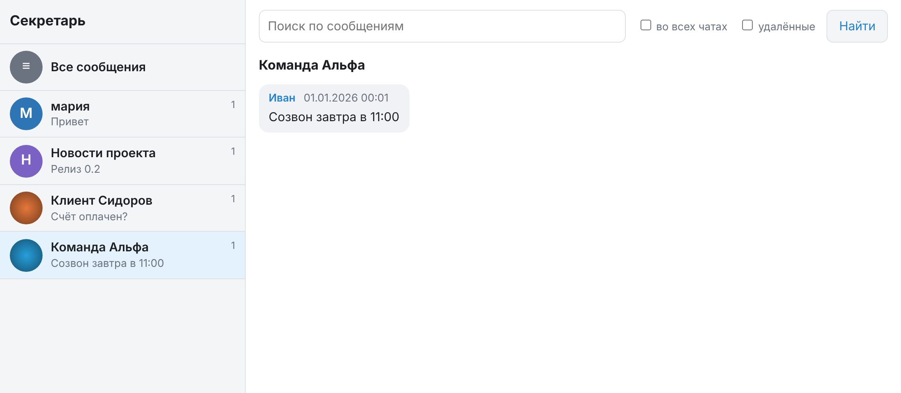

# Веб-интерфейс

Минимальный интерфейс для просмотра и поиска по архиву. Страницы отрисовываются на сервере
(`html/template`), JavaScript не используется, шаблоны и стили вшиты в бинарник.
Работает в командах `serve` на том же адресе, что и MCP. Связанные документы: [настройка](configuration.md),
[архитектура](architecture.md).



## Адрес и включение

- URL: `http://<MCP_ADDR>/`, по умолчанию `http://127.0.0.1:8080/`.
- Включён по умолчанию. Отключается переменной `WEB_UI=false`: тогда `/` отвечает 404, а `/mcp` и `/healthz` работают.
- Интерфейс только читает базу. Отправки сообщений и изменения данных в нём нет.

## Что показывает страница

- Слева список чатов (до 500, самые активные первыми): название (или числовой ID, если названия нет),
  число сообщений и начало последнего сообщения. Первая ссылка «Все сообщения» открывает общую ленту.
- Сверху форма поиска. Если выбран чат, в форме появляется флажок «во всех чатах». Флажок «удалённые»
  добавляет сообщения, помеченные удалёнными (для бизнес-чатов).
- В основной части сообщения: отправитель (имя или `username`), дата в формате `ДД.ММ.ГГГГ ЧЧ:ММ`
  (часовой пояс сервера), метки типа вложения, «изменено» и «удалено». Исходящие сообщения выделены.
  У пересланных сообщений отдельной строкой показано «переслано от …» и дата оригинала.
  Текст экранируется, найденные слова подсвечиваются.

Порядок сообщений во всех режимах один, как в мессенджере: старые сверху, самое свежее внизу.
Страница открывается прокрученной к последнему сообщению; чтобы увидеть более ранние, прокрутите вверх.
Это сделано средствами CSS (контейнер с обратным направлением), без JavaScript.
В общей ленте и в результатах поиска у каждого сообщения указан чат и есть ссылка «в переписке».

На странице 50 самых свежих сообщений выборки. Ссылка «↑ Более ранние» над сообщениями открывает
предыдущие 50, ссылка «Более поздние ↓» под ними возвращает к более новым.

## Параметры запроса

Страница управляется параметрами адресной строки (метод GET, путь `/`):

| Параметр | Значение | Описание |
| --- | --- | --- |
| `chat` | число | ID чата, который нужно показать |
| `q` | строка | Полнотекстовый поиск. Правила те же, что у MCP: [синтаксис поиска](mcp-tools.md#синтаксис-поиска) |
| `everywhere` | `1` | Искать по всем чатам, хотя `chat` задан |
| `deleted` | `1` | Включить удалённые сообщения |
| `offset` | число >= 0 | Сколько сообщений от самого нового пропустить (шаг 50) |
| `around` | число | `message_id`: показать сообщение с окружением; требует `chat` |

Примеры:

```
/?chat=-1001234567890
/?q=билеты+суббота
/?chat=-1001234567890&q=билеты&everywhere=1
/?chat=-1001234567890&around=5120
```

Неверное значение параметра (не число, отрицательный `offset`, `around` без `chat`) даёт `400 bad request`.
Если сообщение для `around` не найдено, ответ `404 message not found`. Любой другой путь, кроме `/` и `/static/`, даёт 404.

Фильтра по отправителю и по времени в интерфейсе нет: для этого используйте [инструменты MCP](mcp-tools.md).

## Поиск и контекст

- Поиск работает так же, как `search_messages`: все слова должны совпасть, слова ищутся по началу,
  регистр не важен. Если выбран чат, поиск идёт только по нему, пока не отмечено «во всех чатах».
- В результатах у каждого сообщения есть ссылка «в переписке →». Она открывает окно из 25 сообщений
  до и 25 после выбранного (`around`), само сообщение подсвечено и прокручивается в видимую область.
- Окно контекста строится по `message_id`, показывает и удалённые сообщения, и не листается.

## Аутентификация

Если задан `MCP_AUTH_TOKEN`, он действует и на интерфейс (включая `/static/`). Браузер покажет окно HTTP Basic:
логин любой, пароль равен токену. Заголовок `Authorization: Bearer <токен>` тоже принимается.
Без токена интерфейс открыт, это допустимо только на loopback-адресе. Вне localhost ставьте TLS-прокси,
иначе пароль уходит по сети открытым текстом ([подробнее](deployment.md#обратный-прокси-и-tls)).

## Заголовки безопасности

Ответы интерфейса содержат:

| Заголовок | Значение |
| --- | --- |
| `Content-Security-Policy` | `default-src 'self'; script-src 'none'; frame-ancestors 'none'` |
| `X-Content-Type-Options` | `nosniff` |
| `Referrer-Policy` | `no-referrer` |
| `Cache-Control` | `no-store` (для страниц, не для стилей) |

Политика запрещает выполнение любых скриптов и встраивание страницы во фреймы, а загрузку ресурсов разрешает
только с того же источника. Это страховка на случай, если в тексте сообщения окажется разметка: текст и так экранируется.
